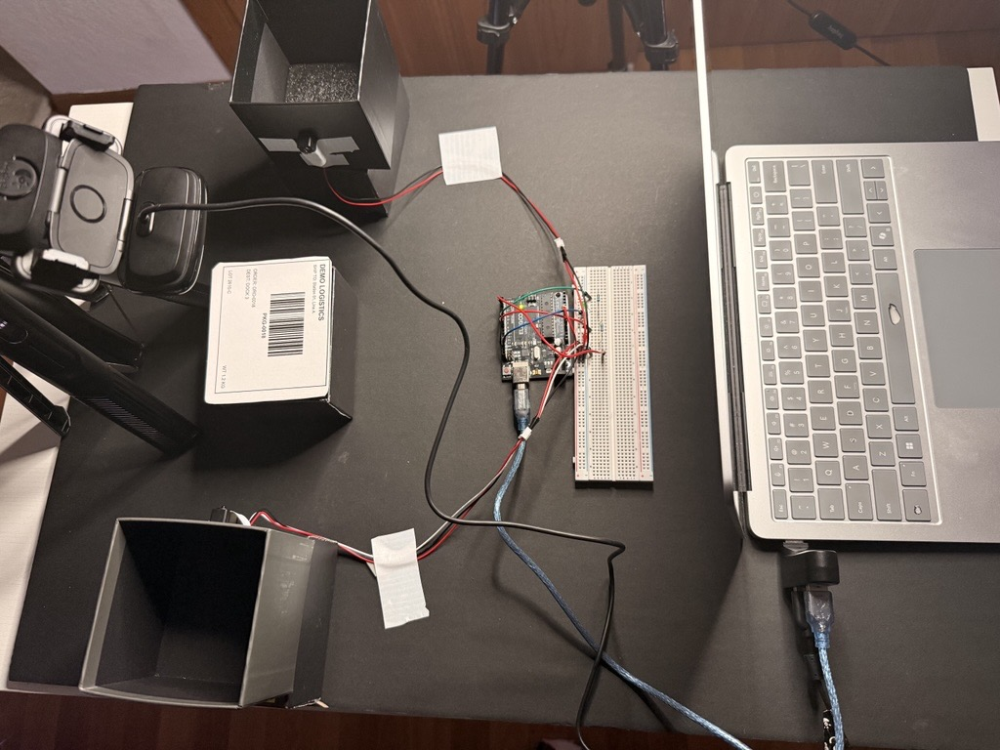
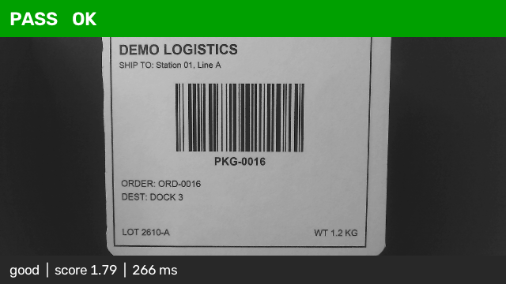
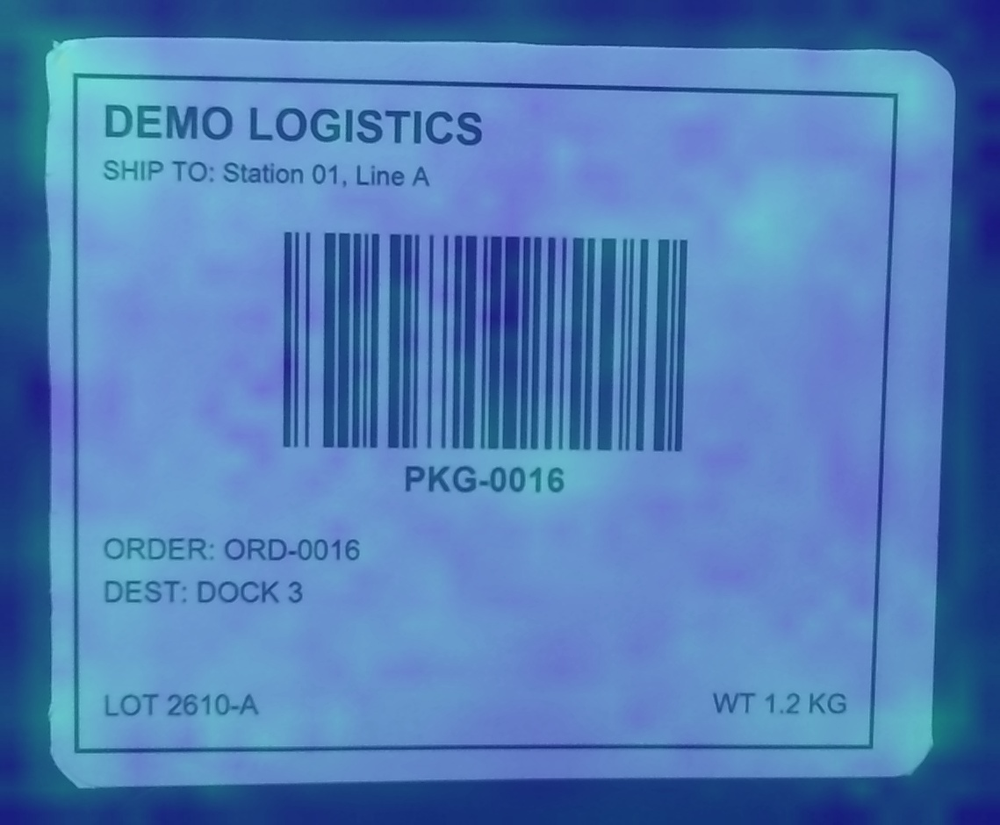
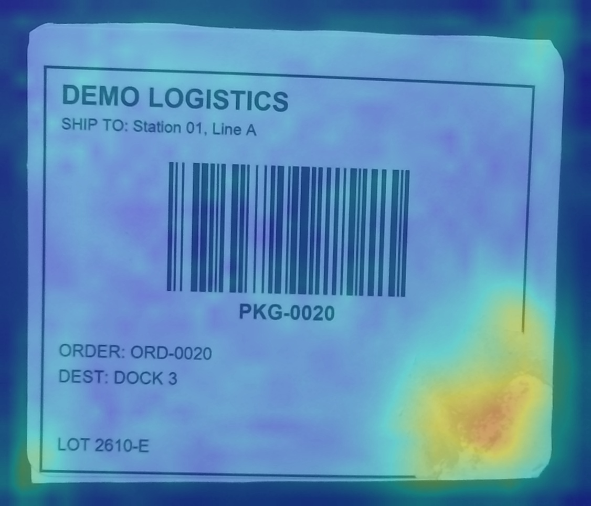
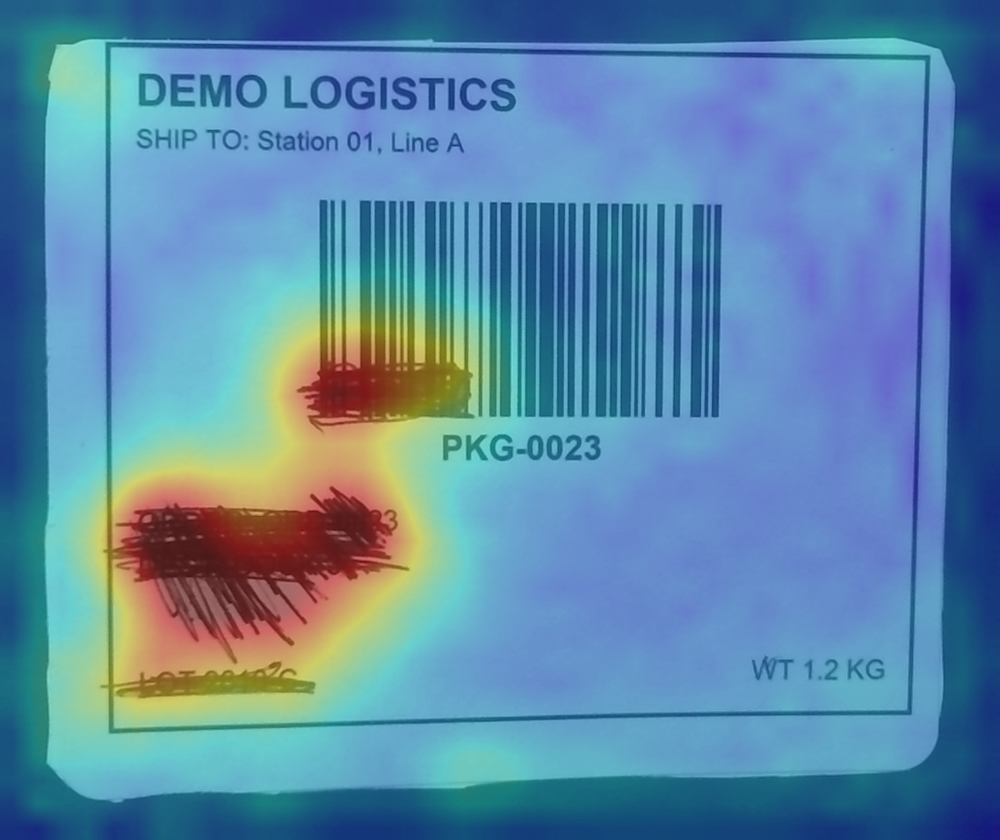
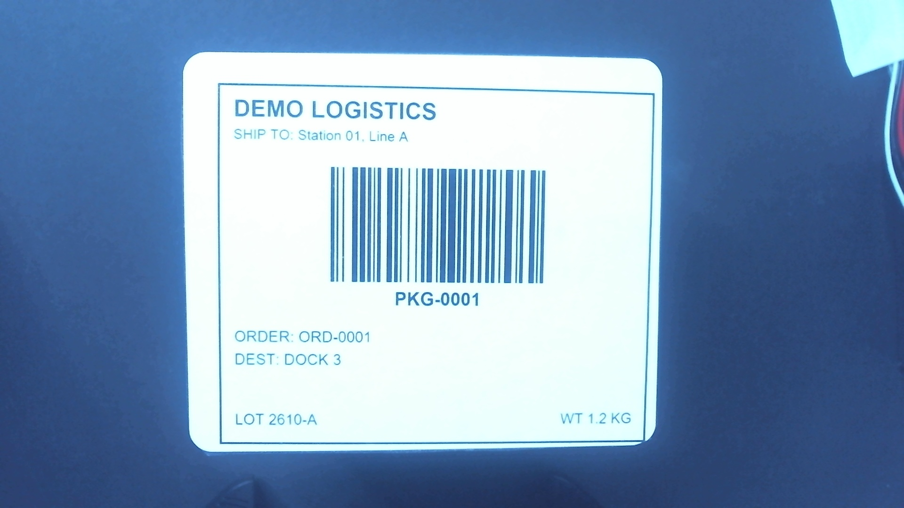

# Label Inspection Station

**An end-to-end machine vision and industrial automation project**

A small parcel label inspection station developed to demonstrate the full vision applications-engineering lifecycle: requirements definition, lighting and optics, machine vision, machine learning, PLC integration, validation, and technical documentation.





A label card is placed on a parcel beneath an overhead camera. Once the operator's hands leave the inspection area, a break-beam sensor triggers an inspection. The vision system evaluates the label, communicates the result to a PLC, and indicates pass or fail using a green/red stack light.

---

## Project Results

The station completed a **28-step, live, guided Factory Acceptance Test (FAT)** with all steps passing.

| Requirement | Acceptance Criteria | FAT Result |
|:---|:---:|:---|
| Defect detection | ≥98% | 6/6 defects detected |
| Missing label detection | ≥98% | 14/14 missing labels detected |
| False rejects | ≤2% | 0/8 good parts rejected |
| Inspection cycle time | <500 ms | 176 ms mean / 266 ms maximum |
| PLC output and logging | Every inspection | Verified at every step |

### Offline Model Evaluation

The model was evaluated on 126 images using a card-level train/test split. Test cards were completely excluded from training.

- **50/50 defects detected**
- The barcode reader alone detected only 14/50 defects.
- Torn, smudged, faded, and skewed labels frequently remain readable by a barcode scanner despite being visibly defective.

**Validation note:** Eight good parts are insufficient to statistically establish a false-reject rate below 2%. Approximately 150 representative good-part inspections would be needed for a more meaningful validation at this level. The FAT results demonstrate functional performance, not production-level statistical qualification.

See the [FAT Report](docs/reports/fat_report.md) for the complete test results.

---

## Machine Vision: What the Model Detects

The anomaly detection model is trained exclusively on good labels. Rather than learning a fixed list of defects, it learns the appearance of acceptable labels and flags deviations.

This allows the system to identify defects that were not explicitly represented in the training dataset.

| Good Label | Torn Corner | Pencil Smudge |
|:---:|:---:|:---:|
|  |  |  |

The heatmaps visualize regions contributing to the anomaly score, providing a way to investigate why a part was rejected.

---

## System Workflow

Each inspection follows a consistent sequence:

1. **Part loading:** The operator places a label card beneath the camera, interrupting the break-beam sensor. The indicator lights turn off while the station is loading.

2. **Inspection trigger:** The operator removes their hands. The beam must be clear and the camera image must remain stable for 0.5 seconds before inspection begins.

3. **Card localization:** The vision system locates the card, measures its orientation, and corrects its perspective before inspection.

4. **Label inspection:** Four independent checks are performed. A failure in any check results in a rejected part.

   | Inspection | Failure Condition |
   |:---|:---|
   | Card presence | No card detected |
   | Orientation | Card tilt exceeds 3° |
   | Barcode readability | Code 128 barcode cannot be decoded |
   | Visual condition | Anomaly score exceeds the calibrated threshold |

   The orientation limit is rule-based. Good cards measured 0–1.9°, while intentionally skewed cards measured 4.6–8.9°.

5. **PLC communication:** The inspection result is transmitted to the PLC over Modbus RTU. Ladder logic controls the green or red indicator, with outputs enabled only while the break-beam is clear.

6. **Inspection logging:** Each part generates a record containing the image, result, rejection reason, anomaly score, measured tilt, and total cycle time.

---

## Engineering Decisions

The project was developed around several practical machine vision and automation principles.

| Design Decision | Engineering Rationale |
|:---|:---|
| Lighting before optics, optics before algorithms | Established repeatable image quality before developing the inspection logic. Camera settings were locked after testing exposure levels and confirming zero clipping with sufficient margin. |
| Anomaly detection instead of defect classification | A PatchCore-style approach using ResNet18 features and a greedy coreset learns from good parts only, reducing dependence on a predefined defect dataset. |
| Split datasets by physical card | Prevented near-identical images of the same card from appearing in both training and testing data. |
| Calibrate thresholds using good images only | Avoided using defect samples to tune the anomaly threshold, reducing evaluation bias. |
| Locate before inspecting | Replaced a fixed image crop with card localization after camera movement exposed the limitations of fixed positioning. |
| Use rules for measurable conditions and ML for appearance | Card orientation is measured geometrically, while visual defects are evaluated using anomaly detection. |

### Lighting and Exposure Selection

Camera exposure was selected through a controlled sweep rather than visual guesswork. The final settings were locked to ensure consistent image acquisition during dataset capture, training, and live inspection.



*Exposure -4 example (overexposed). The selected setting was -6.*

See [Camera Setup](docs/design/camera_setup.md) for the complete setup and calibration process.

---

## Problems Solved During Development

Several issues required systematic troubleshooting across the vision, electrical, and automation systems.

| Issue | Investigation and Resolution |
|:---|:---|
| Break-beam never reported blocked | Isolated the sensor wiring in four steps. The sensor output was driving its own signal; an additional pull-up resistor restored reliable operation. |
| Modbus returned `Illegal Function` | Recognized that an error response confirmed communication was established. The issue was an unenabled Modbus server, not the cable or baud rate. |
| Camera position shifted between capture sessions | Identified the shift before training. Recaptured the dataset in one session to prevent camera movement from becoming a learned defect. |
| Good cards failed after camera movement | Replaced fixed-crop inspection with automatic card localization. |
| Operator's hand remained in the image at trigger time | Added a 0.5-second image stability requirement before triggering inspection. |
| Inspection cycle exceeded 500 ms | Profiled individual processing stages. Removed unnecessary frame waits, the 2× barcode zoom, and a redundant Modbus message. Reduced cycle time from 536 ms to a 176 ms mean. |
| A good card repeatedly failed inspection | Investigated the anomaly heatmap and identified a label edge extending beyond the card. The model correctly identified an unusual appearance. |

These issues helped shape the final system architecture and reinforced the importance of validating the complete application rather than evaluating the vision algorithm in isolation.

---

## Hardware and Software

### Hardware

- Logitech C615 USB webcam mounted on a boom arm
- Heyday LED bar light
- IR break-beam sensor
- Arduino Uno (ELEGOO kit)
- Red and green indicator LEDs
- Avery 15264 labels mounted on foam cards
- Microsoft Surface laptop
- USB hub

### Software and Technologies

| Area | Technology |
|:---|:---|
| Programming | Python 3.12 |
| Image processing | OpenCV |
| Barcode decoding | zxing-cpp |
| Machine learning | PyTorch, torchvision, ResNet18 |
| Anomaly detection | PatchCore-style feature extraction and greedy coreset |
| PLC programming | OpenPLC Editor v4, ladder logic |
| Industrial communication | Modbus RTU, pymodbus |
| Version control | Git, GitHub |
| Backup | Google Drive |

---

## Industrial Application Context

The project uses accessible development hardware while following an architecture representative of an industrial machine vision application.

| Development Station | Comparable SICK-Based Installation |
|:---|:---|
| USB webcam and laptop-based vision software | SICK Inspector / SIM with Nova or AppSpace |
| zxing-cpp barcode decoding | SICK Lector code reader |
| Laptop-trained anomaly detection model | dStudio training with inference on the sensor |
| Arduino Uno and OpenPLC | Customer PLC (Rockwell or Siemens) |
| Modbus RTU | EtherNet/IP or PROFINET |

The hardware is not a direct replacement for industrial equipment. The objective is to demonstrate transferable engineering principles: image acquisition, inspection design, anomaly detection, industrial communication, PLC sequencing, and FAT validation.

---

## Repository Structure

```text
Label-Inspection-Station/
│
├── docs/
│   ├── requirements/
│   │   └── requirements.md       # Requirements and acceptance tests
│   │
│   ├── design/
│   │   ├── architecture.md       # System architecture
│   │   ├── camera_setup.md       # Camera and lighting setup
│   │   └── io_map.md             # Electrical and PLC I/O mapping
│   │
│   └── reports/
│       └── fat_report.md         # Factory Acceptance Test report
│
├── src/
│   ├── inspector.py              # Shared inspection checks
│   ├── locate.py                 # Card detection and alignment
│   ├── train_eval.py              # Model training and evaluation
│   ├── live.py                   # Live inspection loop
│   ├── fat.py                    # Guided FAT execution
│   ├── capture.py                # Guided dataset capture
│   ├── camera.py                 # Camera configuration and self-check
│   └── light_check.py            # Lighting and brightness check
│
├── plc/
│   └── station_plc/              # OpenPLC ladder logic project
│
├── media/
│   ├── results/                  # Inspection results and heatmaps
│   └── setup/                    # Camera and lighting experiments
│
├── requirements.txt
└── README.md
```

---

## Running the Project

### 1. Create a Virtual Environment

```bash
python -m venv .venv
```

Activate the environment:

**Windows:**

```bash
.venv\Scripts\activate
```

**Linux / macOS:**

```bash
source .venv/bin/activate
```

### 2. Install Dependencies

```bash
pip install -r requirements.txt
```

### 3. Verify the Camera and Lighting

```bash
python src/camera.py
python src/light_check.py
```

The lighting check should produce a brightness reading of approximately 94 with card 1 under the configured setup.

### 4. Train and Evaluate the Model

```bash
python src/train_eval.py
```

This trains the anomaly detection model, establishes the inspection threshold, and evaluates performance on the held-out test cards.

### 5. Run the Live Inspection Station

```bash
python src/live.py
```

Requires the station hardware and PLC to be connected. The current configuration expects the PLC on `COM4`.

### 6. Execute the Guided FAT

```bash
python src/fat.py
```

Runs the guided Factory Acceptance Test sequence and records the inspection results.

---

## Data and Documentation

Inspection images are not stored in this repository. The image datasets and backups are maintained separately in Google Drive.

Project documentation, including requirements, design decisions, I/O mapping, camera setup, and FAT results, is maintained in the `docs/` directory.

---

## Project Scope

This project demonstrates an end-to-end machine vision application, from initial requirements through hardware integration and FAT validation.

The primary focus is not simply building an ML model, but engineering a complete inspection system that can acquire consistent images, make repeatable decisions, communicate with industrial controls, and provide measurable evidence of performance.
