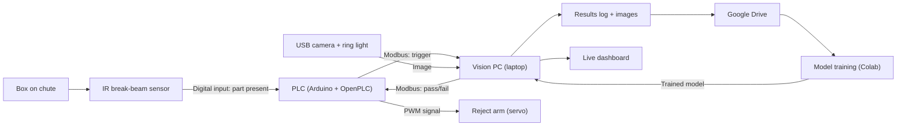

# Label Inspection Station: System Architecture

## Block diagram

## Signal flow for one box

1. The box breaks the IR beam.
2. The PLC sees the beam break and sets a **trigger** flag.
3. The vision PC reads the flag over Modbus and takes a picture.
4. The vision PC runs the checks and the AI model, then reads the barcode.
5. The vision PC writes **pass** or **fail** back to the PLC.
6. On fail, the PLC fires the reject arm.
7. The result, image and timing are logged and shown on the dashboard.

## Components and their industrial equivalents

| This project | Role | Real installation (SICK or typical) |
| --- | --- | --- |
| Logitech USB webcam + ring light + laptop software | Image capture and inspection | SICK InspectorP6xx or Inspector83x vision sensor running SICK Nova |
| IR break-beam sensor | Part-present trigger | SICK through-beam photoelectric sensor |
| zxing-cpp barcode reading | Code 128 reading | SICK Lector image-based code reader |
| Arduino Uno with OpenPLC (ladder logic) | Machine control | Customer PLC (for example Rockwell or Siemens) |
| Modbus | PLC communication | EtherNet/IP or PROFINET |
| Colab model training | AI training in the cloud | SICK dStudio |
| Model running on the laptop | Inference at the edge | AI inference running on the SICK sensor |
| Servo reject arm | Removes bad parts | Pneumatic pusher or diverter |
| Streamlit dashboard | Monitoring | Plant dashboard via OPC UA or MQTT |
