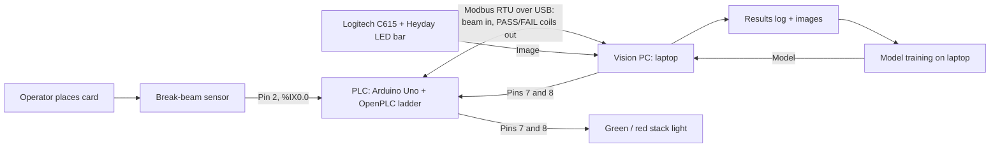

# System Architecture

## Overview

## How one inspection works

1. The operator's hand breaks the beam while placing a card. The laptop reads `beam_clear` over Modbus and clears the result coils, so both lights go off ("loading").
2. The hand leaves: the beam is clear **and** the image has been still for 0.5 s (motion check). This is the trigger.
3. The laptop inspects the current frame (`src/inspector.py`):
   - Locate the card. No card -> FAIL (missing label).
   - Measure its tilt. Above 3 deg -> FAIL (skewed).
   - Straighten and crop the card.
   - Read the Code 128 barcode. No read -> FAIL.
   - Anomaly model score above the threshold -> FAIL (torn, smudged, faded, scratched).
4. The laptop writes the result to the PLC in one Modbus message (coils 0 to 3).
5. The ladder turns on green (pass) or red (fail), only while the beam is clear.
6. The image, result, reason, score, tilt and cycle time are logged.

Measured cycle time (trigger to light): mean 176 ms, max 266 ms. Budget: 500 ms.

## Design choices

| Choice | Why |
| --- | --- |
| Locate, then inspect | A fixed crop broke when the camera was bumped; finding the card first makes the station tolerant to small shifts |
| Rule for skew, model for appearance | Tilt can be measured exactly; tears and smudges can't be listed in advance |
| Anomaly detection (PatchCore-style) | Trains on good parts only; catches defects never seen before |
| Threshold from good images only | No peeking at defects; honest false-reject numbers |
| Laptop reads the beam, PLC drives the light | The PLC keeps control of the outputs; the vision PC only supplies the result |

## This project vs a real SICK installation

| This project | Role | Real installation |
| --- | --- | --- |
| Logitech C615 + LED bar + laptop software | Image capture and inspection | SICK Inspector or a SIM with cameras, running SICK Nova / AppSpace |
| Contour-based card locator | Find the part before inspecting | Part locator / fixture tool in the vision sensor |
| zxing-cpp barcode reading | Code 128 reading | SICK Lector code reader |
| PatchCore model trained on the laptop | Anomaly detection | SICK dStudio (training) + edge inference on the