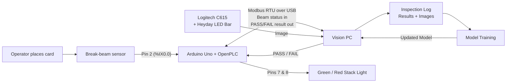

# System Architecture

## Overview



---

## Inspection Workflow

The inspection cycle begins when the operator loads a card into the station and ends when a pass/fail indication is displayed.

### 1. Loading

The operator places a card into the fixture, breaking the beam sensor.

The laptop continuously reads `beam_clear` via Modbus. While the beam is blocked:

- PASS and FAIL result coils are cleared.
- Both stack lights remain off.
- The station is considered to be in the **loading state**.

---

### 2. Trigger Conditions

Inspection begins only when both conditions are met:

- The beam is clear (`beam_clear = TRUE`)
- The image has remained stationary for **0.5 seconds**

The motion check prevents capturing images while the part is still moving.

---

### 3. Image Inspection

The current frame is processed by:

```text
src/inspector.py
```

The inspection consists of the following checks:

#### Card Detection

The card must be located within the image.

Failure condition:

```text
Card not found
```

Result:

```text
FAIL (Missing Label)
```

---

#### Tilt Measurement

The card angle is measured.

Failure condition:

```text
Tilt > 3°
```

Result:

```text
FAIL (Skewed Label)
```

---

#### Image Alignment

The detected card is:

1. Straightened
2. Cropped
3. Normalized for downstream processing

---

#### Barcode Validation

The barcode is read from the aligned crop.

Failure condition:

```text
Barcode cannot be decoded
```

Result:

```text
FAIL
```

Barcode format:

```text
Code 128
```

---

#### Anomaly Detection

A PatchCore-style anomaly model evaluates label appearance.

Examples of detectable defects:

- Tears
- Smudges
- Fading
- Scratches
- Other appearance changes

Failure condition:

```text
Anomaly score exceeds threshold
```

Result:

```text
FAIL
```

---

### 4. PLC Result Update

After inspection completes, the laptop sends the result to the PLC using a single Modbus write.

The PLC receives the PASS/FAIL state through result coils.

---

### 5. Light Indication

The PLC ladder logic controls the stack lights.

Only when the beam is clear:

| Result | Light |
|----------|---------|
| PASS | Green |
| FAIL | Red |

When the beam is blocked:

| Result | Light |
|----------|---------|
| PASS | Off |
| FAIL | Off |

This prevents displaying inspection results while the operator is loading a part.

---

### 6. Data Logging

For every inspection cycle, the system records:

- Source image
- Pass/fail result
- Failure reason
- Anomaly score
- Measured tilt
- Total cycle time

These records are used for traceability and future model training.

---

## Performance

### Inspection Latency

Measured from trigger event to light output:

| Metric | Time |
|----------|---------|
| Average | 176 ms |
| Maximum | 266 ms |
| Design Budget | 500 ms |

### Performance Margin

The worst observed cycle time is:

```text
266 ms
```

This is comfortably below the design target of:

```text
500 ms
```

---

## Key Design Decisions

| Decision | Rationale |
|-----------|------------|
| Locate card before inspection | Fixed crops failed when the camera position shifted. Card localization provides tolerance to small setup changes. |
| Rules for geometry, model for appearance | Card tilt can be measured exactly, while defects such as tears, stains, and fading are difficult to define with fixed rules. |
| Anomaly detection approach | PatchCore-style inspection trains using only good parts and can detect previously unseen defects. |
| Threshold derived from good samples only | Prevents tuning against known bad parts and produces more realistic false-reject measurements. |
| PLC controls outputs | Maintains deterministic control of field devices while the laptop supplies inspection results. |

---

## Comparison to a SICK Industrial Vision System

| This Project | Purpose | Typical SICK Equivalent |
|--------------|---------|-------------------------|
| Logitech C615 + LED lighting + laptop software | Image acquisition and inspection | SICK Inspector or SIM platform with industrial cameras |
| Contour-based card locator | Part detection and alignment | Vision sensor part finder / locator tools |
| `zxing-cpp` barcode reader | Code 128 decoding | SICK Lector barcode readers |
| PatchCore anomaly model | Defect detection | SICK dStudio training and edge inference |
| OpenPLC on Arduino Uno | Machine I/O and signaling | Industrial PLC |
| Modbus RTU over USB | Communication between vision and control systems | Industrial fieldbus or Ethernet protocols |

---

## Data Flow Summary

```text
Operator
    ↓
Break-Beam Sensor
    ↓
OpenPLC (Arduino)
    ↔
Vision PC
    ↓
Image Inspection
    ↓
PASS / FAIL Decision
    ↓
PLC Ladder Logic
    ↓
Stack Light Output
    ↓
Logging & Model Training
```
