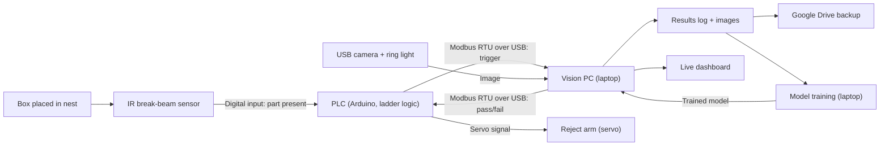

# Label Inspection Station: System Architecture

## Block diagram

## Signal flow for one box

1. The operator places the box in the nest. The nest holds every box in the same position.
2. The box breaks the IR beam. The PLC sets a **trigger** flag.
3. The vision PC reads the flag over Modbus and takes a picture.
4. The vision PC runs the checks and the AI model, then reads the barcode.
5. The vision PC writes **pass** or **fail** back to the PLC.
6. On fail, the PLC fires the reject arm, which pushes the box out of the nest.
7. The result, image and timing are logged and shown on the dashboard.

## Design decisions

| Decision | Choice | Reason |
| --- | --- | --- |
| Part handling | Fixed nest | Same position every time, so the model can be simpler and more accurate |
| Model | ResNet18 features + nearest-good-image distance (PatchCore-style anomaly detection) | Small, fast on CPU (about 40 ms per image), no heavy libraries |
| Training | On the laptop | Takes under a minute; fewer moving parts than cloud training |
| PLC | Arduino running ladder logic (to be confirmed in Phase 6) | Real PLC programming without extra software layers |
| Communication | Modbus RTU over the USB cable | Standard industrial protocol, no network setup |

## Components and their industrial equivalents

| This project | Role | Real installation (SICK or typical) |
| --- | --- | --- |
| Logitech USB webcam + ring light + laptop software | Image capture and inspection | SICK InspectorP6xx or Inspector83x vision sensor running SICK Nova |
| Cardboard nest | Holds the part in a fixed position | Machined part fixture or nest |
| IR break-beam sensor | Part-present trigger | SICK through-beam photoelectric sensor |
| zxing-cpp barcode reading | Code 128 reading | SICK Lector image-based code reader |
| Arduino with ladder logic | Machine control | Customer PLC (for example Rockwell or Siemens) |
| Modbus RTU | PLC communication | EtherNet/IP or PROFINET |
| Training on the laptop | Model training | SICK dStudio (cloud training at scale) |
| Model running on the laptop | Inference at the edge | AI inference running on the SICK sensor |
| Servo reject arm | Removes bad parts | Pneumatic pusher or diverter |
| Streamlit dashboard | Monitoring | Plant dashboard via OPC UA or MQTT |
